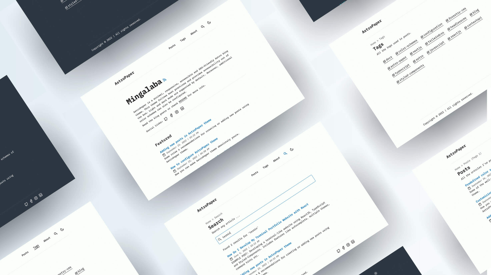

# AstroPaper 📄




[](https://conventionalcommits.org)
[](http://commitizen.github.io/cz-cli/)

AstroPaper is a minimal, responsive, accessible and SEO-friendly Astro blog theme. This theme is designed and crafted based on [my personal blog](https://satnaing.dev/blog).

This theme follows best practices and provides accessibility out of the box. Light and dark mode are supported by default. Moreover, additional color schemes can also be configured.

This theme is self-documented \_ which means articles/posts in this theme can also be considered as documentations. Read [the blog posts](https://astro-paper.pages.dev/posts/) or check [the README Documentation Section](#-documentation) for more info.

## 🔥 Features

- [x] type-safe markdown
- [x] super fast performance
- [x] accessible (Keyboard/VoiceOver)
- [x] responsive (mobile ~ desktops)
- [x] SEO-friendly
- [x] light & dark mode
- [x] fuzzy search
- [x] draft posts & pagination
- [x] sitemap & rss feed
- [x] followed best practices
- [x] highly customizable
- [x] dynamic OG image generation for blog posts [#15](https://github.com/satnaing/astro-paper/pull/15) ([Blog Post](https://astro-paper.pages.dev/posts/dynamic-og-image-generation-in-astropaper-blog-posts/))

_Note: I've tested screen-reader accessibility of AstroPaper using **VoiceOver** on Mac and **TalkBack** on Android. I couldn't test all other screen-readers out there. However, accessibility enhancements in AstroPaper should be working fine on others as well._

## ✅ Lighthouse Score

<p align="center">
  <a href="https://pagespeed.web.dev/report?url=https%3A%2F%2Fastro-paper.pages.dev%2F&form_factor=desktop">
    
  <a>
</p>

## 🚀 Project Structure

Inside of AstroPaper, you'll see the following folders and files:

```bash
/
├── public/
│   ├── assets/
│   │   └── logo.svg
│   │   └── logo.png
│   └── favicon.svg
│   └── astropaper-og.jpg
│   └── robots.txt
│   └── toggle-theme.js
├── src/
│   ├── assets/
│   │   └── socialIcons.ts
│   ├── components/
│   ├── content/
│   │   |  blog/
│   │   |    └── some-blog-posts.md
│   │   └── config.ts
│   ├── layouts/
│   └── pages/
│   └── styles/
│   └── utils/
│   └── config.ts
│   └── types.ts
└── package.json
```

Astro looks for `.astro` or `.md` files in the `src/pages/` directory. Each page is exposed as a route based on its file name.

Any static assets, like images, can be placed in the `public/` directory.

All blog posts are stored in `src/content/blog` directory.

## 📖 Documentation

Documentation can be read in two formats\_ _markdown_ & _blog post_.

- Configuration - [markdown](src/content/blog/how-to-configure-astropaper-theme.md) | [blog post](https://astro-paper.pages.dev/posts/how-to-configure-astropaper-theme/)
- Add Posts - [markdown](src/content/blog/adding-new-post.md) | [blog post](https://astro-paper.pages.dev/posts/adding-new-posts-in-astropaper-theme/)
- Customize Color Schemes - [markdown](src/content/blog/customizing-astropaper-theme-color-schemes.md) | [blog post](https://astro-paper.pages.dev/posts/customizing-astropaper-theme-color-schemes/)
- Predefined Color Schemes - [markdown](src/content/blog/predefined-color-schemes.md) | [blog post](https://astro-paper.pages.dev/posts/predefined-color-schemes/)

> For AstroPaper v1, check out [this branch](https://github.com/satnaing/astro-paper/tree/astro-paper-v1) and this [live URL](https://astro-paper-v1.astro-paper.pages.dev/)

## 💻 Tech Stack

**Main Framework** - [Astro](https://astro.build/)  
**Type Checking** - [TypeScript](https://www.typescriptlang.org/)  
**Component Framework** - [ReactJS](https://reactjs.org/)  
**Styling** - [TailwindCSS](https://tailwindcss.com/)  
**UI/UX** - [Figma](https://figma.com)  
**Fuzzy Search** - [FuseJS](https://fusejs.io/)  
**Icons** - [Boxicons](https://boxicons.com/) | [Tablers](https://tabler-icons.io/)  
**Code Formatting** - [Prettier](https://prettier.io/)  
**Deployment** - [Cloudflare Pages](https://pages.cloudflare.com/)  
**Illustration in About Page** - [https://freesvgillustration.com](https://freesvgillustration.com/)  
**Linting** - [ESLint](https://eslint.org)

## 👨🏻‍💻 Running Locally

The easiest way to run this project locally is to run the following command in your desired directory.

```bash
# npm 6.x
npm create astro@latest --template satnaing/astro-paper

# npm 7+, extra double-dash is needed:
npm create astro@latest -- --template satnaing/astro-paper

# yarn
yarn create astro --template satnaing/astro-paper
```

## Google Site Verification (optional)

You can easily add your [Google Site Verification HTML tag](https://support.google.com/webmasters/answer/9008080#meta_tag_verification&zippy=%2Chtml-tag) in AstroPaper using environment variable. This step is optional. If you don't add the following env variable, the google-site-verification tag won't appear in the html `<head>` section.

```bash
# in your environment variable file (.env)
PUBLIC_GOOGLE_SITE_VERIFICATION=your-google-site-verification-value
```

## 🧞 Commands

All commands are run from the root of the project, from a terminal:

> **_Note!_** For `Docker` commands we must have it [installed](https://docs.docker.com/engine/install/) in your machine.

| Command                              | Action                                                                                                                           |
| :----------------------------------- | :------------------------------------------------------------------------------------------------------------------------------- |
| `npm install`                        | Installs dependencies                                                                                                            |
| `npm run dev`                        | Starts local dev server at `localhost:4321`                                                                                      |
| `npm run build`                      | Build your production site to `./dist/`                                                                                          |
| `npm run preview`                    | Preview your build locally, before deploying                                                                                     |
| `npm run format:check`               | Check code format with Prettier                                                                                                  |
| `npm run format`                     | Format codes with Prettier                                                                                                       |
| `npm run sync`                       | Generates TypeScript types for all Astro modules. [Learn more](https://docs.astro.build/en/reference/cli-reference/#astro-sync). |
| `npm run cz`                         | Commit code changes with commitizen                                                                                              |
| `npm run lint`                       | Lint with ESLint                                                                                                                 |
| `docker compose up -d`               | Run AstroPaper on docker, You can access with the same hostname and port informed on `dev` command.                              |
| `docker compose run app npm install` | You can run any command above into the docker container.                                                                         |

> **_Warning!_** Windows PowerShell users may need to install the [concurrently package](https://www.npmjs.com/package/concurrently) if they want to [run diagnostics](https://docs.astro.build/en/reference/cli-reference/#astro-check) during development (`astro check --watch & astro dev`). For more info, see [this issue](https://github.com/satnaing/astro-paper/issues/113).

## Dependency security

Use Node 22.12 or newer (CI checks Node 22 and 24) with npm 10.9.9 and the
committed `package-lock.json`. The development Compose image also uses Node
22.23.4; its configuration is validated, but the container runtime is not part
of the Node/browser qualification below:

```sh
npm ci
npm audit --audit-level=high
npm run security:runtime
npm run lint
npm run validate
npm exec -- playwright install chromium
npm run security:browser
```

`validate` checks actual Astro files and runs the normal Astro build followed by
Jampack. The diagnostics wrapper rejects a zero-file result. TypeScript 5.9 is
needed for the newer Astro tsconfig's `${configDir}` paths; the old TypeScript
5.3 silently checked zero files with that configuration.

The security workflow uses pinned actions, checks the PR's exact source commit,
has read-only contents permission and no provider secrets, and fails its
`Security workspace` aggregate if either Node job fails, is cancelled or is
skipped. Preserve the existing app-pinned `Socket Security: Pull Request Alerts`
rule. Add the aggregate as required only after successful hosted checks and a
current completed Socket inventory for the merged default-branch commit.

The Astro 7 migration keeps React 18, Tailwind 3, content/frontmatter, public copy
and Jampack 0.23.2. Direct PostCSS integration replaces the Astro Tailwind adapter,
whose peer range excludes Astro 7. The explicit remark processor retains TOC and
collapse plugins, the Shiki transformer preserves code wrapping, and content
entries use `id`/`render(entry)` while retaining frontmatter slugs. The PNG route moves to
`[slug].png.ts` to preserve the original flat endpoints. Imported frontmatter
images use `getImage()` so their metadata refers to emitted assets. A build-time
check validates the original 1200 by 630 minimum for relative images, including
drafts, because content-layer schemas resolve image metadata after parsing. Framework
asset names may change; the legacy article/tag/pagination, RSS, sitemap and
twelve generated OG endpoint URLs are covered by the fixtures.

Scoped npm overrides patch Jampack's Sharp 0.35.5, Undici 6.29.1, esbuild 0.25.12,
file-type 21.3.4 and SVGO 3.3.5 without replacing its optimizer. Other
version-scoped overrides patch vulnerable CLI/parser leaves. The selector parser
and temporary-file fixes cross older major ranges because those ranges have no
patched releases. Retain the native, full build and browser qualification when
updating or removing these overrides. Compatible unrelated direct resolved
versions remain unchanged. Avoid forced audit fixes and blanket alert ignores.

The native fixture runs Jampack's actual image/JavaScript compressors, AVIF
encoding/decoding, SVG handling, image detection, an owned-loopback Undici fetch,
and the production draft/scheduled-post sorter. Browser checks exercise the 65
legacy routes, real React/Fuse search, theme/client navigation, touch menu,
TOC/heading/code-copy controls, pagination, local images, metadata and actual OG
PNG dimensions. They own a preview at `127.0.0.1:43140`, refuse an occupied port
or local runtime environment files, and stop it afterwards. Existing remote
editorial media and Google Fonts are excluded from this loopback-only test.
The build retains its existing public OG font downloads and real Satori/Resvg
generation. These checks do not certify remote media availability or a deployed
site.

The old Astro Studio workflow only checked `astro:db` schemas. This repository
has no Astro DB integration, and [Astro Studio shut down on March 1,
2025](https://astro.build/blog/goodbye-astro-studio/). Read-only security CI
replaces that unused mutable action and its PR-write permission. No remote DB,
provider setting, credential or deployment is changed by this workflow.

Brandon Johnson is the accountable security owner; the repository maintainer
owns remediation. Triage malware/exploited findings immediately, critical
findings within 24 hours and high findings within seven days. Record advisory,
package/version, manifest, dev/runtime scope, exposure, owner, due date and exact
patch/check/Socket evidence in a repository issue. Risk acceptance needs a
bounded reason and review/expiry date. Follow the [fleet operations
guide](https://github.com/excelsior-creative/all-workspaces/blob/main/docs/socket-security-operations.md)
and [rollout tracker](https://github.com/excelsior-creative/all-workspaces/issues/6).
Source checks, merge, provider publication and live verification remain separate
claims; the existing upstream `SITE.website` is not proof of an Excelsior-hosted
deployment.

## ✨ Feedback & Suggestions

If you have any suggestions/feedback, you can contact me via [my email](mailto:contact@satnaing.dev). Alternatively, feel free to open an issue if you find bugs or want to request new features.

## 📜 License

Licensed under the MIT License, Copyright © 2023

---

Made with 🤍 by [Sat Naing](https://satnaing.dev) 👨🏻‍💻 and [contributors](https://github.com/satnaing/astro-paper/graphs/contributors).
